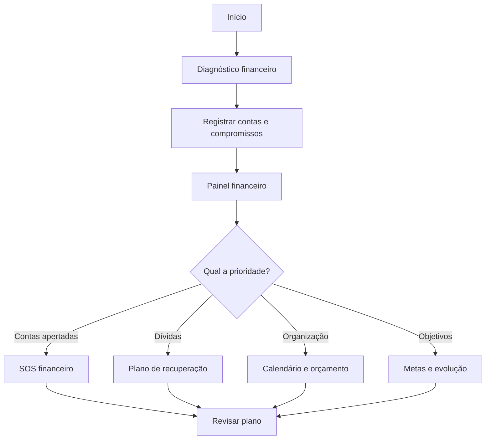
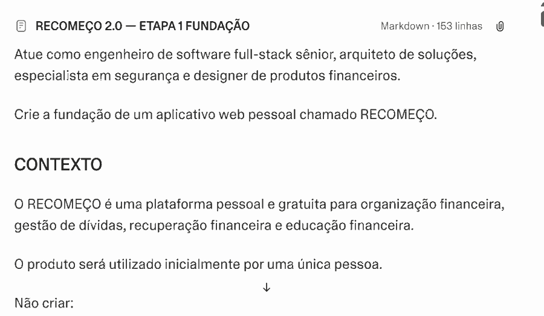
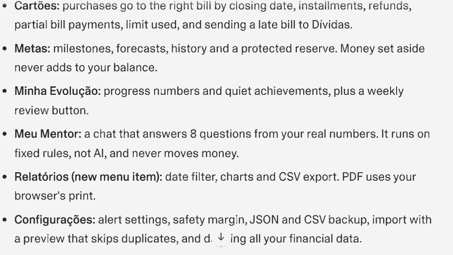
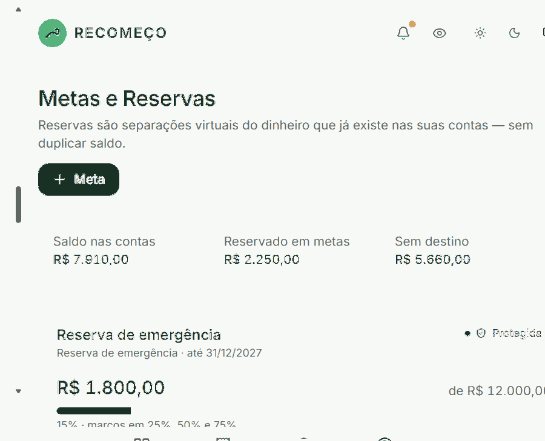

# 🌱 RECOMEÇO — Seu dinheiro, sua evolução

  <strong>Organização financeira, recuperação de dívidas e planejamento para uma vida mais equilibrada.</strong>

  <a href="https://sight-right-app.lovable.app/"><strong>🚀 Acessar demonstração do aplicativo</strong></a> ·
  <a href="./docs/PRD.md">📋 PRD e prompt</a> ·
  <a href="./docs/PROCESSO-E-APRENDIZADOS.md">🧠 Vibe Coding e aprendizados</a> ·
  <a href="./docs/EVIDENCIAS.md">📷 Evidências</a>

> **Projeto desenvolvido como entrega do desafio [App de Organização de Finanças Pessoais com Vibe Coding](https://github.com/digitalinnovationone/dio-lab-vibe-coding-app-financas), da DIO.**
>
> **Atenção:** este repositório documenta o conceito, o processo de criação e o link de demonstração. As funcionalidades descritas abaixo são o **escopo projetado**, e não uma certificação de que todos os módulos estejam concluídos. O código gerado pelo Lovable não foi sincronizado neste fork até esta documentação ser publicada.

## 📌 Visão geral

O **RECOMEÇO** nasceu da ideia de que um aplicativo financeiro deve fazer mais do que mostrar receitas e despesas: ele deve ajudar a pessoa a compreender sua situação, visualizar compromissos futuros e organizar um caminho realista de recuperação.

Em vez de exigir conhecimentos avançados de finanças, a experiência proposta utiliza linguagem simples, indicadores claros, simulações e orientações contextualizadas. Seu público inclui quem tem dívidas acumuladas, renda apertada, dificuldades com cartões ou simplesmente quer desenvolver hábitos mais saudáveis.

**Modelo escolhido:** uso pessoal, gratuito e sem recursos de monetização.

### 🎯 Problema

Muitas pessoas não conseguem manter um controle financeiro contínuo porque as ferramentas parecem complexas, demandam registro manual frequente e nem sempre ajudam a decidir *o que fazer a seguir*. Quando existem dívidas, a falta de uma visão integrada de vencimentos, renda e compromissos dificulta ainda mais o planejamento.

### 💡 Solução proposta

Uma plataforma centrada no usuário que une:
- Registro de contas, receitas, despesas e cartões.
- Acompanhamento de dívidas e possíveis negociações.
- Planejamento de fluxo de caixa por data.
- Simuladores de compras, pagamentos e cenários futuros.
- Metas e acompanhamento de evolução.
- Mentor financeiro educativo, inicialmente apoiado em regras e cálculos verificáveis.

## 🔗 Demonstração

### [👉 Abrir RECOMEÇO no Lovable](https://sight-right-app.lovable.app/)

**URL fornecida pelo autor:** https://sight-right-app.lovable.app/

> A disponibilidade e as funcionalidades efetivamente presentes na demonstração devem ser conferidas no próprio ambiente Lovable. Não utilize informações financeiras reais em capturas de tela públicas.

## ✨ Funcionalidades planejadas

| Módulo | Proposta |
| --- | --- |
| 💰 Meu dinheiro | Contas, receitas, despesas, categorias e transferências |
| 📊 Dashboard | Indicadores, compromissos e visão do saldo |
| 📅 Calendário financeiro | Recebimentos, vencimentos e fluxo de caixa |
| 💳 Cartões | Faturas, limites e compras parceladas |
| 🤝 Central de dívidas | Credores, parcelas, negociações e simulações de quitação |
| 🆘 SOS financeiro | Apoio ao planejamento diante de insuficiência de recursos |
| 🛒 Posso comprar? | Avaliação do impacto de uma compra no orçamento |
| 🔮 Meu eu do futuro | Comparação de cenários de 3, 6 e 12 meses |
| 🎯 Metas | Reserva de emergência e objetivos financeiros |
| 🌱 Minha evolução | Marcos de aprendizado e hábitos financeiros |
| 💬 Meu mentor | Orientações educativas com dados e regras verificáveis |
| 📈 Relatórios | Análises por período e categoria |

**Critério de implementação:** cada recurso deverá estar conectado a dados reais e receber testes; nenhuma interface ilustrativa deve ser apresentada como funcionalidade concluída.

## 🧭 Fluxo de uso idealizado

## 🧠 Vibe Coding: processo criativo

O projeto foi definido por meio de **engenharia de prompts**, adotando um ciclo de:
1. Identificar o problema real e o público-alvo.
2. Especificar um **PRD (Product Requirements Document)**.
3. Definir os módulos e priorizar o MVP.
4. Usar o Lovable para transformar requisitos em protótipo/aplicação.
5. Refinar pedidos para reduzir ambiguidades, retrabalho e consumo de interações.
6. Documentar decisões, limitações, testes e próximos passos.

📋 [Ler o PRD e o prompt consolidado](./docs/PRD.md).

🧠 [Ler o processo, os desafios e os aprendizados](./docs/PROCESSO-E-APRENDIZADOS.md).

## 🧱 Arquitetura de referência

Tecnologias e práticas **especificadas para o desenvolvimento**, sujeitas à confirmação na exportação do código:

| Camada | Proposta |
| --- | --- |
| Interface | React, TypeScript, Tailwind CSS e shadcn/ui |
| Visualização | Recharts e componentes responsivos |
| Backend | Supabase / Lovable Cloud, conforme configuração do projeto |
| Persistência | PostgreSQL e regras de acesso por usuário |
| Segurança | Autenticação, validação de entradas, RLS e privacidade |
| Motor financeiro | Cálculos determinísticos, valores monetários exatos |
| IA | Mentor baseado em regras; LLM opcional em evolução |

O projeto prioriza **separação entre saldos realizados e projeções**, prevenção de lançamentos duplicados e proteção de informações financeiras.

> Este fork é a entrega documental do desafio. Para executar localmente, será necessário sincronizar/exportar o código-fonte do projeto Lovable e então seguir as instruções do `package.json` e do provedor de backend efetivamente utilizado. Nenhuma credencial privada deverá ser publicada.

## 🔐 Privacidade e responsabilidade

- Não publicar extratos, valores reais de dívidas, documentos pessoais, senhas ou tokens.
- Proteger dados privados por autenticação e políticas de autorização.
- Não confundir receitas previstas com dinheiro disponível.
- Não tratar o assistente como consultor profissional nem prometer resultados financeiros.
- Utilizar dados fictícios em demonstrações e capturas.

## 🧪 Validação sugerida

O MVP deve ser avaliado com cenários como:
- Registrar receita, despesa e transferência sem duplicar saldos.
- Visualizar pagamentos previstos separados de pagamentos realizados.
- Simular uma compra e seu impacto em datas futuras.
- Comparar planos de quitação sem presumir juros desconhecidos.
- Confirmar que nenhum usuário consegue acessar dados de outra conta.

**Estado dos testes:** não verificado neste repositório documental.

## 🗺️ Roadmap

- **Fundação:** identidade visual, autenticação e arquitetura.
- **MVP financeiro:** contas, receitas, despesas, calendário e dashboard.
- **Recuperação:** dívidas, cartões, negociações e projeções.
- **Evolução:** metas, simuladores e educação financeira.
- **Qualidade:** segurança, acessibilidade, testes e exportação de backup.

Esse roadmap representa planejamento; não é uma lista de entregas já validadas.

## 📷 Evidências reais do desenvolvimento

Os prints abaixo foram fornecidos pelo autor e mostram o processo de elaboração do prompt, a resposta da ferramenta e uma tela do aplicativo no Lovable.

### 1. Engenharia do prompt — fundação do projeto

### 2. Iteração e resposta do Lovable

### 3. Interface — Metas e Reservas

**O que foi visualmente evidenciado:** prompt inicial, resposta do Lovable e interface do módulo Metas e Reservas. As imagens, por si só, não validam persistência, testes, cálculos ou a conclusão de todos os módulos.

[Ver detalhes e orientações das evidências](./docs/EVIDENCIAS.md).

## 💭 Reflexão

O maior aprendizado foi perceber que **o valor do Vibe Coding está na qualidade das instruções, não apenas na quantidade de código gerado**. Detalhar necessidades, casos de borda, proteção de dados e critérios de aceite permite orientar a ferramenta com mais precisão.

Um desafio importante é equilibrar o desejo de incluir muitos recursos com a necessidade de validar o básico — especialmente quando se trabalha com dinheiro, em que um erro de cálculo compromete a confiança no produto.

O próximo passo é comparar o escopo planejado com o que foi de fato implementado, registrar evidências reais e corrigir lacunas antes de considerar o aplicativo pronto para uso financeiro contínuo.

## 👨‍💻 Autor

**Luiz Pedrão**  
GitHub: [@LuizPedrao](https://github.com/LuizPedrao)

**Projeto educacional para a [Digital Innovation One (DIO)](https://www.dio.me/).**

---

<strong>RECOMEÇO — Porque organizar o amanhã começa com um passo hoje. 🌱</strong>

